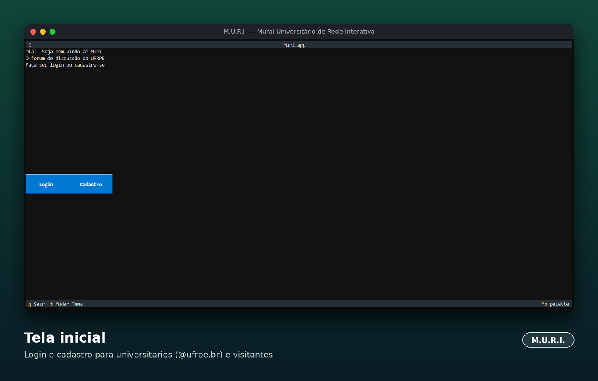
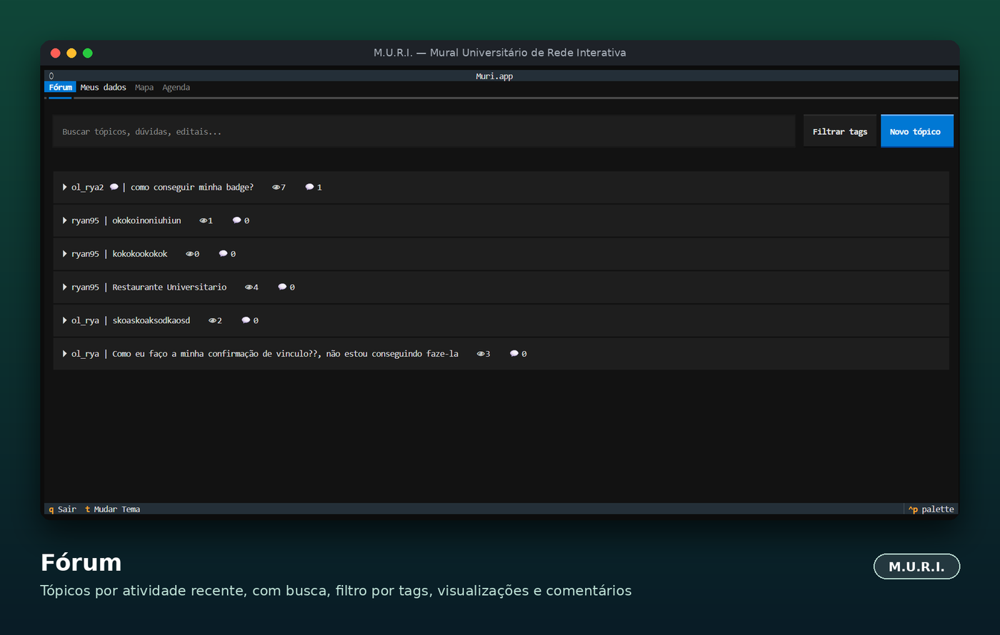
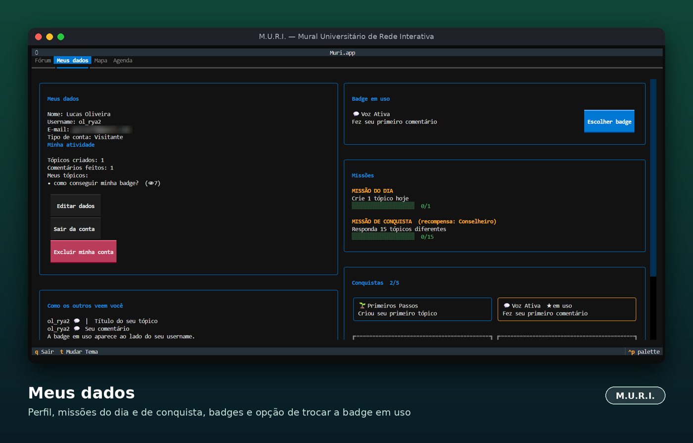
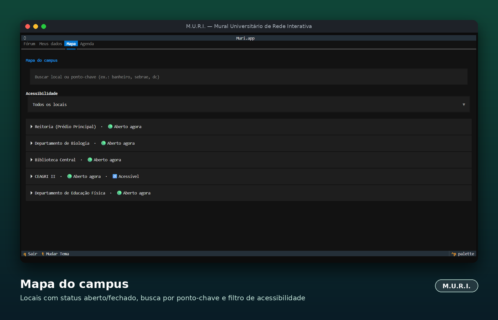

<a id="topo"></a>
<div align="center">

# 🎓 M.U.R.I. - Mural Universitário de Rede Interativa

**Fórum aberto para a comunidade acadêmica e alunos visitantes da Universidade Federal Rural de Pernambuco (UFRPE)**

<br/><br/>

<p align="center">
  
</p>

</div>

---

## 📑 Sumário

- [Sobre o projeto](#sobre)
- [Funcionalidades](#funcionalidades)
- [Preview](#preview)
- [Requisitos funcionais](#requisitos-funcionais)
- [Fluxogramas](#fluxogramas)
- [Estrutura do projeto](#estrutura)
- [Equipe](#equipe)
- [Tecnologias](#tecnologias)
- [Como executar](#como-executar)
- [Licença](#licenca)

<a id="sobre"></a>
## 📖 Sobre o projeto

O **M.U.R.I.** (Mural Universitário de Rede Interativa) é um mural interativo e aberto que conecta a comunidade da UFRPE. Focado na colaboração entre alunos e visitantes, o projeto centraliza a troca de informações acadêmicas, permitindo que estudantes resolvam problemas em conjunto e construam comunidades ativas dentro do ambiente universitário.

Além do fórum, a plataforma reúne outras funcionalidades pensadas para o dia a dia de quem estuda na universidade:


- um **mapa interativo** do campus, com horários, pontos-chave e recursos de acessibilidade;
- uma **agenda** de eventos, com busca e filtros;
- um sistema de **tags** para facilitar a busca e a filtragem de tópicos;
- um sistema **gamificado de badges e missões** para reconhecer a participação dos usuários;
- **moderação pelo próprio autor**: cada usuário pode apagar seus tópicos e comentários.

<a id="funcionalidades"></a>
## ✨ Funcionalidades

- 💬 **Fórum geral** — criação de tópicos, respostas, busca e filtro por tags
- 🗑️ **Moderação de conteúdo** — o autor pode apagar os próprios tópicos e comentários (com confirmação)
- 🗺️ **Mapa do campus** — listagem dos locais com status "aberto/fechado agora", endereço, andares, pontos-chave (banheiros, departamentos, serviços...) e links para o Google Maps
- 🔎 **Busca no mapa** — por nome do local, ponto-chave ou sinônimo (ex.: `wc`, `dc`, `sebrae`), ignorando acentos
- ♿ **Acessibilidade** — indicação e filtro de recursos de acessibilidade dos locais (elevador, vagas exclusivas)
- 📅 **Agenda** — criação e exclusão de eventos, com busca e filtro
- 🏅 **Badges e missões** — conquistas permanentes e uma missão sorteada por dia; a badge escolhida aparece ao lado do username
- 👤 **Perfil** — edição de dados, troca de badge em uso, saída e exclusão da conta

- 🏷️ **Tags** — organização e busca de tópicos

<a id="preview"></a>
## 🖼️ Preview

<div align="center">
  
  <p><em>Tela inicial: login e cadastro para universitários (@ufrpe.br) e visitantes</em></p>
  <br/>
  
  <p><em>Fórum: tópicos por atividade recente, busca, filtro por tags, visualizações e comentários</em></p>
  <br/>
  
  <p><em>Perfil: dados, missões do dia e de conquista, e galeria de badges</em></p>
  <br/>
  
  <p><em>Mapa do campus: status aberto/fechado, busca por ponto-chave e filtro de acessibilidade</em></p>
</div>

<a id="requisitos-funcionais"></a>
## 📋 Requisitos funcionais


### Release 1 (1ª VA)


| RF | Módulo | O que faz |
|---|---|---|
| RF001 - Cadastro e Login | Usuário | Cadastro e visualização de conta como universitário (e-mail `@ufrpe.br`) ou visitante — nome, username, e-mail e senha. |
| RF002 - Criação de tópico | Fórum | Criação de um novo tópico no fórum global: título, tags opcionais, mensagem e anexos (imagem/vídeo até 25&nbsp;MB) — exige cadastro. |
| RF003 - Responder tópico | Fórum | Resposta a um tópico existente; a resposta é salva e o contador de respostas do tópico é atualizado — exige cadastro. |
| RF004 - Listagem de tópicos | Fórum | Listagem dos tópicos do fórum global, ordenados por atividade recente, com título, tags, número de respostas e visualizações. |
| RF005 - Busca e filtro | Fórum | Busca por texto em tempo real combinada com filtro por tags (ex.: SISU, matrícula, bolsas e estágio). |

### Release 2 (2ª VA)

| RF | Módulo | O que faz |
|---|---|---|
| RF006 - Listagem de eventos | Agenda | Listagem dos eventos criados na agenda. |
| RF007 - Criar evento | Agenda | Criação de eventos na agenda (título, data, horário, descrição e local) — exige cadastro. |
| RF008 - Excluir evento | Agenda | Exclusão de um evento da agenda pelo seu autor. |
| RF009 - Busca e filtro de eventos | Agenda | Busca por texto e filtros na listagem de eventos. |
| RF010 - Badges e missões | Gamificação | Sistema de badges e missões: missões de conquista (rendem badge) e missão diária sorteada; a badge em uso aparece ao lado do username. |
| RF011 - Apagar tópicos | Moderação de conteúdo | O usuário apaga os tópicos que criou (os comentários e anexos do tópico também são removidos). |
| RF012 - Apagar comentários | Moderação de conteúdo | O usuário apaga os comentários que fez. |
| RF013 - Listagem de locais | Mapa | Listagem dos locais do campus com endereço, horário de funcionamento, status aberto/fechado e pontos-chave. |
| RF014 - Busca e filtro de locais | Mapa | Busca e filtro de localidades específicas, por nome, ponto-chave ou sinônimo. |
| RF015 - Acessibilidade | Acessibilidade/Mapa | Indicação e filtro de recursos de acessibilidade dos locais do campus. |

### Planejado (próximas entregas)

| Módulo | O que faz |
|---|---|
| Cursos | Aba de cursos: cada curso tem seu espaço com grade curricular, documentação, contatos e um fórum restrito aos alunos daquele curso. |

<a id="fluxogramas"></a>
## 🔀 Fluxogramas

> 📎 Aqui está o arquivo único com todos os fluxogramas: [`todos-os-fluxogramas.pdf`](docs/fluxogramas/todos-os-fluxogramas.pdf).

<a id="estrutura"></a>
## 🗂️ Estrutura do projeto

```text
muri/
├── main.py                  # ponto de entrada
├── requirements.txt
├── data/                    # acesso a dados (SQLite) e arquivos estáticos
│   ├── armazenamento.py     # usuários, tópicos e respostas
│   ├── gamificacao_db.py    # badges e missões
│   ├── gamificacao.json     # catálogo de badges e missões
│   ├── locais.json          # locais do campus
│   └── anexos/              # anexos enviados nos tópicos
├── features/                # regras de negócio
│   ├── autenticacao.py
│   ├── forum.py
│   ├── gamificacao.py
│   ├── mapa.py
│   └── perfil.py
├── interface/               # telas e widgets (Textual)
│   ├── menu_principal.py
│   ├── menu_login.py
│   ├── menu_cadastro.py
│   ├── tela_forum.py
│   ├── tela_perfil.py
│   ├── painel_mapa.py
│   └── item_local.py
├── models/                  # dataclasses (Cadastro, Topico, Resposta)
├── utils/                   # formatação e arquivos
├── assets/                  # imagens do preview
└── docs/
    └── fluxogramas/         # PDFs dos fluxogramas
```

<a id="equipe"></a>
## 👥 Equipe

| Nome | Matrícula | Função |
|---|---|---|
| Luis Fernando Melo | _preencher_ | Desenvolvedor |
| Ryan Freitas Oliveira | _preencher_ | Desenvolvedor |

<a id="tecnologias"></a>
## 🛠️ Tecnologias


- **Front-end:** `Textual` — construção da interface interativa no terminal.
- **Back-end:** `Python`
- **Banco de dados:** `SQLite` — banco de dados relacional que utiliza SQL.
- **Dados estáticos:** `JSON` — catálogo de locais do campus e de badges/missões.
- **Outras ferramentas e bibliotecas (biblioteca padrão):**
  - `sqlite3` — conexão e operações com o banco de dados;
  - `json` — leitura dos catálogos de locais e de gamificação;
  - `pathlib` — manipulação de caminhos e arquivos;
  - `uuid` — geração de identificadores únicos;
  - `datetime` — datas, horários e cálculo de "aberto/fechado agora";
  - `unicodedata` — busca sem acentos no mapa;
  - `webbrowser` — abertura dos links do Google Maps;
  - `random` — sorteio da missão diária;
  - `shutil` — operações com arquivos e diretórios.


<a id="como-executar"></a>
## 🚀 Como executar o projeto

```bash
# 1. Clonar o repositório
git clone https://github.com/ryanfreitasoliveira/muri.git
cd muri

# 2. Instalar as dependências
pip install -r requirements.txt

# 3. Executar o projeto
python main.py
```

O banco `dados/muri.db` e as tabelas (incluindo as de gamificação) são criados automaticamente na primeira execução.

<a id="licenca"></a>
## 📄 Licença

Este projeto está sob a licença MIT. Veja o arquivo [LICENSE](LICENSE) para mais detalhes.

---

<div align="center">

Feito por alunos da UFRPE 🎓

[⬆ voltar ao topo](#topo)

</div>